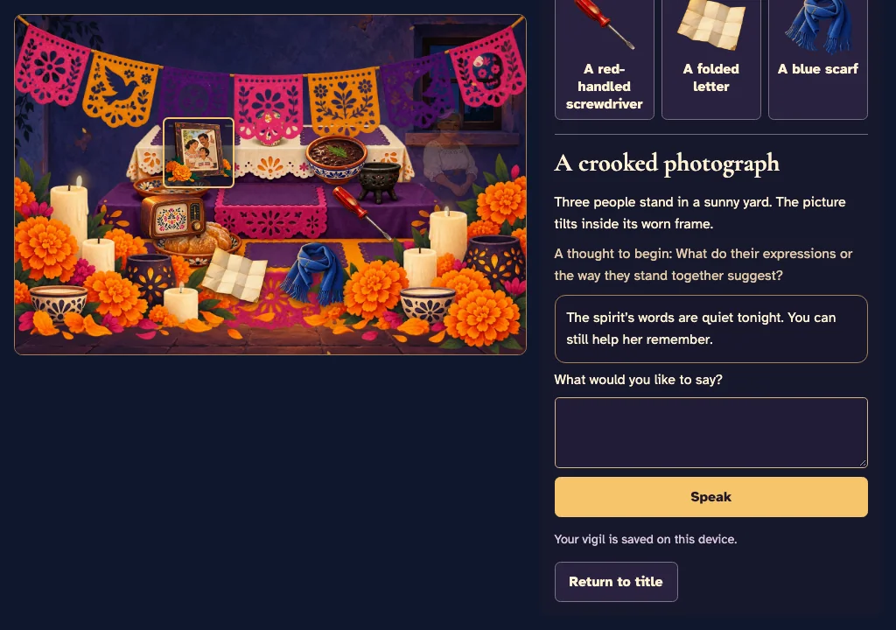
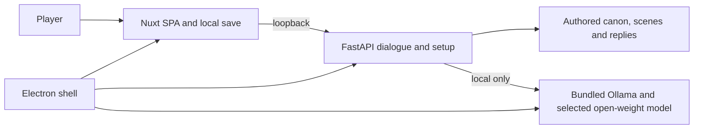

# La Última Vela / The Last Candle

A bilingual, offline narrative game about remembrance, candlelight and a life waiting to be remembered.

On the night of November 1, a spirit returns to an ofrenda but cannot remember who she was. Sit beside her, examine the objects left for her, and talk until dawn. Each conversation moves the night forward. The game is designed for a 15–20 minute visit; playtest timing is still being checked.





The game is available in English and Spanish. It was made for the [DEV Hacktoberfest Open-Source AI Challenge: Ghost in the Machine](https://dev.to/challenges/hacktoberfest-week4-2026-10-26).

## Install and play

Download the installer for your system from the project's [releases](https://github.com/RZEROSTERN/hacktoberfest-week5/releases) when a release has been published. Verify its SHA-256 against the accompanying `SHA256SUMS` file. Installers do not include the model weights.

- **macOS, Apple silicon:** open the arm64 DMG and drag LastCandle to Applications. This build is ad-hoc signed and not notarized. macOS may block it on first launch; Apple's [instructions for opening an app from an unidentified developer](https://support.apple.com/en-us/102445) describe the per-app exception. Use it only if you trust the file and its source.
- **Windows 11, x64:** run the x64 setup executable and follow the installer. It is unsigned; Windows may warn or block it. [Microsoft's Smart App Control guidance](https://support.microsoft.com/en-us/windows/security/threat-malware-protection/smart-app-control-frequently-asked-questions) explains its behavior. Do not turn off system protection simply to run a file you do not trust.
- **Linux, x64:** make the AppImage executable and open it, or install the `.deb` with your distribution's package manager. For example: `chmod +x LastCandle-<version>-x86_64.AppImage` followed by `./LastCandle-<version>-x86_64.AppImage`, or `sudo apt install ./last-candle_<version>_amd64.deb`. AppImage support and package dependencies vary by distribution.

On first launch, choose whether to download the recommended model (about 1.3 GB). Downloading needs an internet connection and starts only after your consent. Once it is installed, the game runs offline. You can also choose authored fallback mode without downloading a model; your own reflection decides whether a message connects to an object. Sound is optional and starts only when enabled.

The macOS installer and the CI-built packages have component smoke checks. Actual installation and playtesting on Windows and Linux, a fresh download, whole-game memory use and an independent playtest are still being verified; see [build evidence](docs/BUILD_SIZES.md).

## How the spirit stays coherent

The spirit has a fixed, authored bilingual life. The local model classifies a player's message and chooses an allowed reply ID for the object and game state. Code resolves that ID to an authored line before the typewriter effect begins; generated prose is never displayed. Code also controls the clock, recovery and endings. Invalid output, timeouts and unavailable models fall back to authored text.

The boundary prevents generated prose from inventing life facts. Relevance classification can still be wrong. The benchmark reports those errors rather than claiming the model understands every message.

## Model comparison

On one M2 Pro Mac with 16 GB, the prepared authored-reply pipeline was tested against two 120-message bilingual corpora. Times below are warm p95 safe-display latency; peak is the conservative measured Ollama process-tree memory. Preparation is measured separately.

| Model | Original accuracy | Held-out accuracy | Safe display p95 | Engine peak | Decision |
| --- | ---: | ---: | ---: | ---: | --- |
| Qwen 3.5 0.8B | 87.5% | 90.8% | 0.45 s | 1.85 GB | Recommended |
| Gemma 3 1B | 85.8% | 83.3% | 0.53 s | 1.08 GB | Held-out accuracy below target |

Earlier free-prose tests of Gemma 4 E2B and E4B measured 5.98 GB and 9.63 GB conservative peak engine memory, respectively, and exposed canon-validation gaps. Those results use a different pipeline and are not directly comparable to the table. Full methods, limitations and results are in [BENCHMARKS.md](docs/BENCHMARKS.md).

## Why open source matters here

After the optional model download, the vigil can continue with the lights and the internet off. Player messages and saves remain on the computer; no hosted inference service receives them. The code, story, prompts and model selection are inspectable, and the model can be replaced by adapting the local catalog and checking compatibility. This version recommends only the tested small model: a replacement needs its own accuracy, memory and safety evaluation.

## Architecture



The shell starts its own loopback services and isolated model directory, limits inference concurrency and cleans up the owned process tree on exit. Model weights are downloaded only with consent; no runtime API keys or cloud inference are used.

## Development

Use Node 24.21.0 and Python 3.12 with `uv`. From the repository root:

```sh
npm ci
npm run setup
npm run dev
npm run check
npm run dist
```

`npm run check` runs lint, type checks and tests. `npm run dist` builds the installer for the current supported OS using the same scripts as CI. The project uses GitFlow: feature branches target `develop`, and release branches target `master`. See [AGENTS.md](AGENTS.md) for the full commands and constraints, and [DECISIONS.md](docs/DECISIONS.md) for technical decisions.

## Remembrance and credits

Día de los Muertos is a living tradition of remembrance, with many family and community practices. This fictional story treats the returning spirit with care and dignity; its unease comes from the quiet and the approaching dawn.

The original illustrations were generated during development using a closed image model through a ChatGPT subscription, then reviewed and optimized. The game never calls that tool. All runtime AI uses open-weight models locally. Fonts are open licensed, the sound is procedural, and the art prompts, sources and licenses are in [CREDITS.md](CREDITS.md) and [ART_PROMPTS.md](docs/ART_PROMPTS.md).
